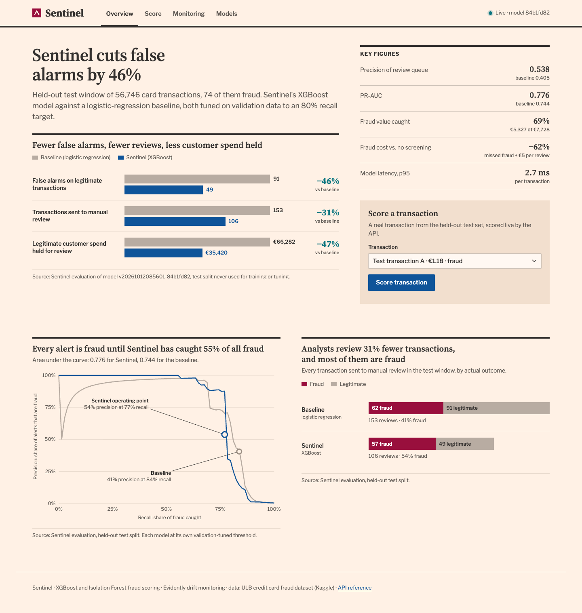
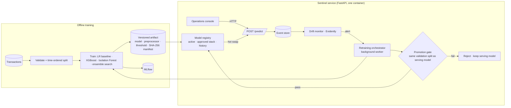

<div align="center">

# Sentinel

**Real-time card fraud detection with drift monitoring and gated, automated retraining.**

An end-to-end ML system: an XGBoost and Isolation Forest scoring API, Evidently drift monitoring, a model registry with a promotion gate and rollback, and a fraud-operations console, shipped as one Docker container.




</div>

## Results

Evaluated on a **held-out, time-ordered test window of 56,746 real card transactions** that the model never saw during training or tuning. Sentinel is compared with a logistic-regression baseline, with both models' thresholds tuned on validation data to an 80% recall target.

| | Baseline | **Sentinel** | Change |
|---|---:|---:|---:|
| False alarms on legitimate transactions | 91 | **49** | **−46%** |
| Transactions sent to manual review | 153 | **106** | **−31%** |
| Legitimate customer spend held for review | €66,282 | **€35,420** | **−47%** |
| Precision of the review queue | 0.405 | **0.538** | **+33%** |
| PR-AUC | 0.744 | **0.776** | **+0.032** |
| Fraud cost vs. no screening¹ | | **−62%** | |

| Latency (Apple M-series laptop, 1 worker) | p50 | p95 | p99 |
|---|---:|---:|---:|
| Model inference, single transaction | 1.9 ms | 2.0 ms | 2.1 ms |
| `POST /predict` end to end over HTTP | 3.8 ms | 4.2 ms | **9.7 ms** |
| `POST /predict/batch`, 100 transactions | 10.9 ms | 11.0 ms | 11.1 ms |
| Throughput at concurrency 8 | **260 requests/s** | | |

<sub>¹ Missed fraud value plus €5 per manual review, compared with letting every transaction through. Full reports: [model evaluation](reports/model_evaluation_report.md) · [benchmark](docs/benchmarks.md).</sub>

## What it does

- **Scores transactions in real time.** `POST /predict` validates the payload, applies the training-time preprocessing, and returns a fraud probability, an anomaly rank, a risk level and an APPROVE / REVIEW decision in under 10 ms.
- **Watches its own inputs.** Every scored transaction is logged. Evidently compares recent traffic with the serving model's reference data feature by feature, and also checks for prediction drift.
- **Retrains itself, safely.** Drift alerts or a manual request start a background retraining run. The candidate is promoted only if it passes a validation gate against the serving model, and is otherwise rejected and kept for audit.
- **Gives the fraud team a console.** A purpose-built dashboard served by the same API shows impact, live scoring, drift checks and the model registry with one-click rollback.

## Architecture



## Engineering highlights

**Machine learning done rigorously**
- **No leakage by construction.** The split is chronological (60/20/20 by transaction time). Preprocessing is fitted on the training data only. Thresholds, ensemble weights and model selection use validation data only, and the test split is scored exactly once.
- **Built for extreme imbalance (0.17% fraud).** XGBoost uses `scale_pos_weight` instead of resampling, early-stops on validation PR-AUC, and is evaluated on PR-AUC, precision and recall rather than accuracy.
- **Business-aware operating point.** The threshold maximises precision subject to a recall target. Results are reported both statistically and in money: fraud value caught, legitimate spend held, and total cost.
- **Uncertainty reported.** Every test metric comes with 95% bootstrap confidence intervals.
- **Automated model selection.** XGBoost is compared with XGBoost + Isolation Forest blends on validation PR-AUC. The simpler model serves unless a blend wins by a set margin.

**MLOps**
- **Versioned, tamper-evident artifacts.** Each version bundles the model, preprocessor, threshold, drift reference, metrics and a SHA-256 manifest, which is verified before every load or promotion.
- **Registry with an audit trail.** It tracks candidate, approved, rejected and rolled-back versions. Promotion hot-swaps the serving model with no restart, and rollback re-verifies the previous artifact first.
- **Promotion gate.** The candidate and the serving model are scored on the same validation split. A candidate is promoted only if it clears recall and precision floors, has at least 30 validation frauds behind it, and does not lose PR-AUC.
- **Drift monitoring with Evidently.** Per-feature drift and prediction drift are computed against the serving model's own reference. HTML reports are stored, and alerts can trigger retraining automatically.
- **Retraining state machine.** Runs move from `pending` to `checking`, `training` and `evaluating`, then end as `promoted`, `rejected`, `failed` or `skipped`. A single worker prevents concurrent runs, and runs orphaned by a crash are marked failed at startup.
- **Experiment tracking.** Every training run logs its parameters and metrics to MLflow.

**Software engineering**
- **FastAPI with strict Pydantic v2 schemas.** Unknown, missing, non-finite or out-of-range fields return HTTP 422, and nothing is silently defaulted.
- **42 automated tests** cover validation, splitting, leakage invariants, artifact tamper detection, API contracts, drift triggers, promotion and rejection paths, rollback, and drift-to-retraining end to end.
- **CI on GitHub Actions** runs lint (ruff), the tests, a smoke test and a Docker build.
- **One container** serves the API, the console and the retraining worker. Model state persists on a volume, and a health check is built in.
- **A reproducible latency benchmark** reports p50, p95 and p99 for model-only, HTTP, batch and concurrent load.
- **Cloud deployment scripts** for Azure ML managed online endpoints, with blue/green slots, a smoke test and traffic-switch rollback.

## The operations console

| Score a transaction | Drift monitoring | Model registry |
|---|---|---|
|  |  |  |
| Real held-out transactions scored live, with the decision placed on the fraud-probability scale against the review threshold. | A simulated traffic shift, Evidently checks on every feature, alert status, and the full reports. | Every version and retraining run, a one-click retrain through the promotion gate, and rollback. |

The console is hand-built HTML, CSS and JavaScript with charts drawn in SVG. It has no frontend framework and no CDN dependency, and every figure on it is served live by the API.

## Quick start

**Prerequisites:** Python 3.11 and Docker. Download `creditcard.csv` from the [Kaggle Credit Card Fraud dataset](https://www.kaggle.com/datasets/mlg-ulb/creditcardfraud) into `data/raw/`.

```bash
# 1. Install
python3.11 -m venv .venv && source .venv/bin/activate
pip install -r requirements-dev.txt          # macOS: brew install libomp (needed by XGBoost)

# 2. Train, evaluate, benchmark
python scripts/train.py                      # trains all models, registers and activates the best one
python scripts/evaluate.py                   # writes reports/model_evaluation_report.md
python scripts/benchmark.py --spawn          # writes reports/benchmark.md

# 3. Run: console at http://localhost:8000, API docs at http://localhost:8000/docs
make serve
```

**With Docker:**

```bash
python scripts/train.py                      # or train inside the container (see below)
docker compose up -d --build                 # console + API on http://localhost:8000
# docker compose run --rm api python scripts/train.py
```

**Tests:** `make test` · `make lint` · `make smoke`

## API

| Endpoint | Purpose |
|---|---|
| `POST /predict` | Score one transaction: fraud probability, anomaly rank, risk level, decision |
| `POST /predict/batch` | Score up to 500 transactions |
| `GET /model/info` · `/model/evaluation` · `/model/versions` | Serving model metadata, full evaluation, registry |
| `POST /monitor/events` · `/monitor/evaluate` · `/monitor/simulate` | Ingest events (with optional delayed labels), run a drift check, simulate a shift |
| `GET /monitor/status` · `/monitor/reports/{id}/html` | Latest drift status and Evidently HTML reports |
| `POST /retraining/trigger` · `/retraining/rollback` · `GET /retraining/status` | Start a gated retraining run, roll back, view run history |
| `GET /health` · `/metrics` | Health check; request counts and live latency percentiles |

```bash
# examples/transaction.json is a real fraudulent transaction from the held-out test window
curl -s -X POST localhost:8000/predict -H 'content-type: application/json' -d @examples/transaction.json
# {"fraud_probability": 0.9969, "anomaly_score": 0.98, "risk_category": "HIGH", "decision": "REVIEW", ...}
```

## Project structure

```
app/
  api/          FastAPI service, request/response schemas
  dashboard/    operations console (static HTML/CSS/JS, served at /)
  data/         schema validation, time-ordered splitting
  features/     preprocessing pipeline (fitted on training data only)
  models/       training, scoring, metrics, versioned artifacts
  monitoring/   event store, Evidently drift checks, simulation
  registry/     model registry: promotion, rejection, rollback
  retraining/   orchestrator state machine and promotion gate
scripts/        train · evaluate · benchmark · simulate_drift · smoke_test
examples/       sample transaction for the API
tests/          42 tests on synthetic fixtures (no dataset needed)
deployment/     Azure ML managed online endpoint scripts
docs/           architecture, engineering decisions, evaluation, benchmarks
```

More detail: [architecture](docs/architecture.md) · [engineering decisions](docs/engineering_decisions.md) · [model evaluation](docs/model_evaluation.md) · [benchmarks](docs/benchmarks.md) · [Azure ML deployment](docs/azure_ml.md)

## Tech stack

Python 3.11 · pandas · NumPy · scikit-learn · XGBoost · Evidently · FastAPI · Pydantic v2 · Uvicorn · MLflow · SQLite · Docker Compose · GitHub Actions · pytest · ruff · Azure ML SDK v2

## Data

[Credit Card Fraud Detection](https://www.kaggle.com/datasets/mlg-ulb/creditcardfraud) by the Machine Learning Group of ULB and Worldline: 284,807 European card transactions over two days, 0.17% fraud. Features `V1`–`V28` are PCA components; `Amount` is in EUR. Database Contents License (DbCL) v1.0. The data is not redistributed in this repository.
